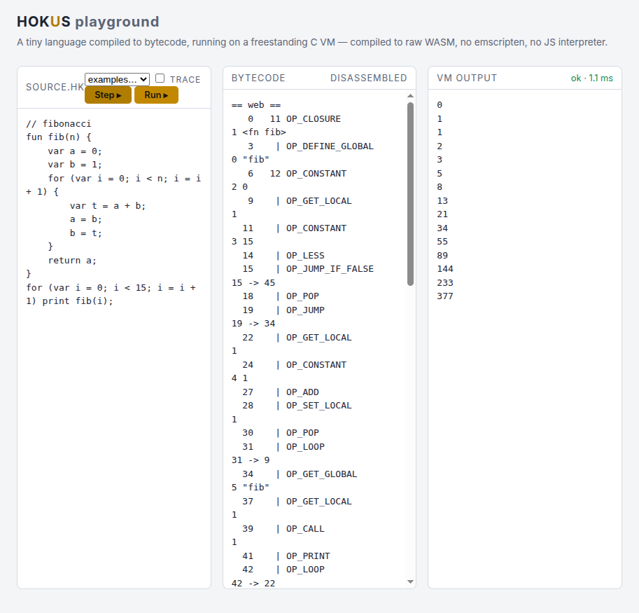

# HOKUS

A complete programming language stack, built from the metal up in freestanding C —
and the *same VM* running natively on Linux and in the browser as raw WebAssembly.

```
source ─► lexer ─► Pratt parser ─► single-pass bytecode compiler ─► stack VM
                                                                  │
                                        native CLI (libc) ───────┴────── WASM (no libc)
```



## The layers

| Layer | Where | Notes |
|---|---|---|
| Bytecode VM | `src/vm.c` | stack machine, 64 call frames, call-by-value functions |
| Objects | `src/value.c` | heap strings (FNV-1a hashed interning key), custom `%.14g` formatter |
| Globals | `src/table.c` | open-addressing hash table with tombstones |
| Front end | `src/lexer.c`, `src/compiler.c` | Pratt parser, single-pass codegen, locals, jumps for `if`/`while`/`for`/`and`/`or` |
| Tooling | `src/debug.c` | disassembler (`--disasm`) |
| Native host | `src/main.c` | REPL + file runner |
| Browser host | `src/wasm_shim.c` | bump allocator over a static 16 MB heap, output captured in a static buffer — **zero imports, zero emscripten** |
| Webapp | `web/index.html` | playground: source editor, live bytecode pane, execution trace, **step-through debugger**; JS only shuttles bytes in/out, all logic is the C VM |
| GC | `src/gc.c` | mark-sweep over the VM's root set; the WASM arena sweeps by unlinking |

## Language

```lox
fun mod(a, b) {
    while (a >= b) a = a - b;
    return a;
}
for (var i = 1; i <= 20; i = i + 1) {
    if (mod(i, 15) == 0) print "FizzBuzz";
    else if (mod(i, 3) == 0) print "Fizz";
    else print i;
}
```

Numbers (doubles), booleans, nil, strings with escapes and `+` concat; globals &
block-scoped locals; `if/else`, `while`, `for`, `and`, `or`, `!`; first-class
functions with recursion and **closures**; **classes** with methods, initializers,
`this`, inheritance, and `super`; `print`; a `clock()` native. Deviations from
stock Lox: no `static` methods (skipped in the corpus harness, loudly).

## Performance

Recursive `fib(28)` (~1.03M calls): **~46 ms native**, **~54 ms raw WASM** in Node
(warm; ~96 ms cold on first instantiation) — dispatch is a computed-goto jump table
(labels as values) on both hosts. A 200k-iteration method-call loop runs
**~25 ms native, ~30 ms WASM** — `OP_INVOKE`/`OP_SUPER_INVOKE` dispatch directly
without allocating a bound-method object per call (~24% faster than the
GET_PROPERTY+CALL path). The no-libc WASM build tracks within **~1.2× of native** —
same C object code, same clang. Reproduce: `node tests/bench.js`.

## Build & run

```bash
make                  # native: bin/hokus
make wasm             # web/hokus.wasm — clang --target=wasm32, no stdlib, no emscripten
bin/hokus examples/fib.hk
bin/hokus             # REPL
bin/hokus -d examples/strings.hk   # disassembler
bin/hokus -t examples/fib.hk       # execution trace
bin/hokus -s examples/fib.hk       # token dump (jlox format)
bin/hokus --slice 100 examples/fib.hk   # run in 100-instruction slices
npm run playground    # serve web/ at http://localhost:8000
make artifact         # hokus-artifact.html — whole playground, one file, WASM embedded
```

## Verification — the external gate

Self-written golden tests (`tests/golden/`) are not the claim. The claim is the
**official Crafting Interpreters Lox test corpus** (Bob Nystrom, MIT) — a
third-party suite that knows nothing about this implementation:

```bash
./tests/fetch_lox.sh   # clones the corpus once
make test
```

Current: **247 passed, 14 smoke, 0 failed, 4 skipped** — the skips are documented
divergences (16-bit constant pool by design; jlox REPL-semantics files). Scan-mode
(`--scan`, jlox token-dump format) covers the corpus's `scanning/` chapter.

The same `make test` also gates the **WASM boundary** (`tests/wasm_runner.js`):
every golden program runs identically under raw WASM, and the exported API surface
(`hk_run`, `hk_run_trace`, `hk_disasm`, `hk_prepare`/`hk_step`) is checked —
including the property that budgeted step slices produce byte-identical output to
a full run. Natively, `--slice N` runs any program in N-instruction budgeted
slices, so the re-entrant interpreter is gated on both hosts. `HOKUS_SLICE_SWEEP=1
./tests/run.sh` re-runs the entire corpus at `--slice 17`, proving the pause/resume
interpreter byte-identical across all 266 third-party programs, not just goldens.

## Design notes

- **One allocator boundary.** Core code never calls `malloc` directly; everything
  goes through `HK_REALLOC`. Native builds map that to `realloc`, the WASM build
  to a bump allocator over a static heap — so the VM is the same object code in
  both worlds.
- **One output boundary.** `hkEmit` is a host-provided sink: `fputs` natively,
  a buffer the JS host drains in the browser. Compiler errors, runtime errors,
  and `print` all flow through it.
- **Mark-sweep GC.** Collection runs against the active VM's stack, frames, and
  globals; on the WASM host, sweeping only unlinks (the bump arena never frees),
  reset wholesale between runs.
- **Re-entrant interpreter.** All execution state lives in the `VM` struct, so the
  run loop is `vmStart` + `vmRunSlice(budget)` — pause/resume at instruction
  granularity. That's what makes the browser's step-through debugger a thin shell
  over `hk_step`, not a separate interpreter.

## License

MIT — see [LICENSE](LICENSE).
